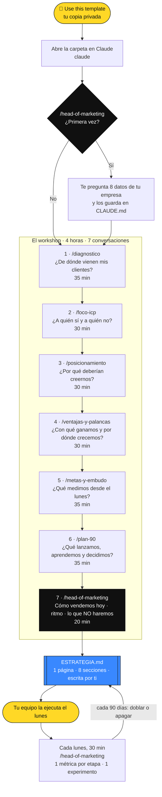
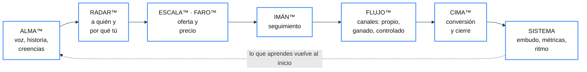

# En 4 horas tendrás la estrategia de marketing que tu equipo puede ejecutar el lunes. Una página. Escrita por ti.

**Metodología AI Huevos 🥚** · Un Head of Marketing que vive dentro de Claude, hace las preguntas correctas
en el orden correcto y no te deja salir con una estrategia vaga.

---

### La mayoría de las empresas que conocemos no tienen un problema de marketing. Tienen un problema de decisión.

Venden. Tienen clientes que se quedan años. Tienen un producto que, cuando alguien lo prueba, convence.
Y aun así, cuando les preguntas de dónde vino su último cliente, la respuesta honesta es: *"nos llegó"*.

No hay embudo que mirar. No hay un cliente ideal escrito. El diferencial existe, pero solo lo conoce el fundador.
Y el fundador es, casi siempre, la misma persona que vende, cobra y contrata.

Este repositorio no te va a vender una agencia ni un curso de 40 horas. Te da algo más útil y más incómodo:
**siete conversaciones** con un Head of Marketing que no acepta "más o menos" como respuesta.

---

## Lo que tendrás al final (y lo que no)

Al cerrar el workshop, el archivo `ESTRATEGIA.md` tendrá ocho secciones llenas **con tus palabras**:

| § | Al final sabrás… |
|---|---|
| 1 | De dónde vinieron, de verdad, tus últimos 10 clientes y en qué capa de tu marketing está el cuello de botella |
| 2 | A quién le vendes primero y, más difícil, **a quién le dices que no** |
| 3 | Por qué el mercado debería **creerte**, no solo escucharte: cada diferencial atado a una prueba |
| 4 | Tus 3 ventajas reales, la palanca de crecimiento #1 y los 2 canales para los próximos 90 días |
| 5 | Tu embudo mínimo, sus 4 números y 3–5 metas que se pueden medir sin comprar software |
| 6 | Qué lanzas en 30 días, qué aprendes en 60 y qué decides en 90 |
| 7 | Cómo vendes hoy (escrito, por fin) y la reunión semanal que mantiene vivo el plan |
| 8 | Lo que **no** vas a hacer, con su porqué. Es la sección que más tiempo te devuelve |

**Lo que no tendrás:** un documento de 60 diapositivas que nadie vuelve a abrir. Ni respuestas inventadas.
El kit no escribe tu posicionamiento ni tus metas. Pregunta, propone opciones y **tú decides**.
Si un número es estimado, queda marcado `(estimado)`. Si algo está por confirmar, queda `[A VALIDAR]`.

---

## Cómo funciona, en un solo dibujo



---

## Las 7 capas: el idioma de la Metodología AI Huevos

Tu marketing no tiene "una" madurez. Tiene siete. Una empresa puede cerrar como campeona y, a la vez, no saber
qué le dice el mercado de ella. Por eso el diagnóstico mide **capa por capa** (de M0 Exploración a M4 Escala),
y cada conversación del kit trabaja una capa concreta.



| Conversación | Capa que trabaja | La pregunta que no te deja esquivar |
|---|---|---|
| `/diagnostico` | todas | "De tus últimos 10 clientes, ¿cuántos llegaron por algo que tú controlas?" |
| `/foco-icp` | RADAR™ | "¿A qué tipo de cliente le vas a decir que no este trimestre?" |
| `/posicionamiento` | RADAR™ · ALMA™ | "¿Qué puede comprobar un prospecto en 10 minutos?" |
| `/ventajas-y-palancas` | FLUJO™ · ESCALA™ | "Si todo te llega por referidos, ¿por qué no los pides?" |
| `/metas-y-embudo` | SISTEMA | "¿Cuánto tardas en cerrar? Medido, estimado o no sabemos." |
| `/plan-90` | IMÁN™ · CIMA™ | "¿Quién es el dueño y cuál es la fecha?" |
| `/head-of-marketing` | SISTEMA · CIMA™ | "¿Qué haces tú en la primera reunión que hace que te compren?" |

---

## Siete reglas que el kit no rompe

1. **Pregunta antes de proponer.** De a 2 o 3 preguntas, nunca un formulario.
2. **Nunca inventa datos.** Ni clientes, ni cifras, ni ventajas. Lo que no sabes queda escrito como "no sé", y eso también es un hallazgo.
3. **Trabaja con lo que ya existe.** No asume CRM, presupuesto de pauta ni equipo de marketing. Pide lo que tú ya sabes de memoria.
4. **Sin embudo visto no hay canal nuevo.** Sin diferencial verificable no hay pauta.
5. **Todo lo omitido se nombra.** Lo que descartas va a "Lo que NO haremos", con su porqué.
6. **Una página.** Si tu equipo no la lee en 5 minutos, sobra algo.
7. **Respeta el reloj.** Cada conversación tiene un tope. Lo que no cabe queda como tarea, con fecha.

---

## Qué hay en este repositorio

```
head-of-marketing-ai-huevos/
├── README.md            ← estás aquí
├── EMPIEZA-AQUI.md      ← cómo abrirlo, el orden del workshop y los tiempos
├── CLAUDE.md            ← la identidad de tu Head of Marketing: reglas, contexto de tu empresa, router
├── ESTRATEGIA.md        ← tu estrategia de 1 página (empieza vacía; la llenas tú)
└── .claude/skills/      ← las 7 conversaciones; Claude las carga solas
    ├── head-of-marketing/      el orquestador: qué sigue, cómo vendes hoy, ritmo, cierre
    ├── diagnostico/            origen de tus clientes + madurez por capa + Fuel, Engine, Ecosystem
    ├── foco-icp/               cliente ideal por tiers, a quién no, entrevistas a clientes
    ├── posicionamiento/        homepage, posicionamiento en 6 pasos, diferencial → prueba, hero
    ├── ventajas-y-palancas/    13 ventajas → top 3, 4 palancas, canales, Stop / Start / Continue
    ├── metas-y-embudo/         embudo mínimo y sus 4 números, metas KPI · Proyectos · Ops
    └── plan-90/                briefs GACCS, experimento a costo cero, plan 30-60-90
```

Cada skill tiene dos archivos: `SKILL.md` (cómo conversa contigo) y `reference.md` (el framework completo, por si
quieres leerlo con calma).

---

## Empieza en 3 pasos

1. **Haz tu copia.** Botón verde **"Use this template" → Create a new repository**. Déjala **privada**: ahí va a vivir tu estrategia.
   ¿Sin GitHub? `git clone https://github.com/ai-huevos/head-of-marketing-ai-huevos.git mi-head-of-marketing`
2. **Ábrela en Claude.** En una terminal dentro de la carpeta escribe `claude`, o abre la carpeta como proyecto en la app de escritorio.
3. **Escribe `/head-of-marketing`.** La primera vez te pide los datos de tu empresa. Después, te dice qué sigue.

**Ten a mano:** tus últimos 10 clientes (cómo llegaron, cuánto pagan, cuánto tardaron en cerrar), tu facturación aproximada y la URL de tu sitio.
Si no tienes un número, está bien. Un "no sé" honesto vale más que un número bonito.

---

## De dónde viene esto

La Metodología AI Huevos se construyó sobre los mejores frameworks de marketing B2B y los tradujo a la realidad de
una empresa latinoamericana que crece sin equipo de marketing y sin presupuesto de pauta: Fuel, Engine y Ecosystem,
ventajas de marketing, las 4 palancas de crecimiento, metas en 3 tipos y briefs GACCS de **MKT1** (Emily Kramer &
Kathleen Booth); el posicionamiento en 6 pasos de **April Dunford**; gancho, historia y oferta, y el mapa de creencias,
de **Russell Brunson**; y la disciplina de validación y experimentos de **Maja Voje**. Las 7 capas del Códice GTM
(ALMA™, RADAR™, ESCALA™, FARO™, IMÁN™, FLUJO™, CIMA™) son de AI Huevos.

---

> *P.D. Lo más difícil de este kit no es llenarlo. Es leer la sección 8 en voz alta frente a tu equipo y
> sostenerla un trimestre entero. Las empresas que lo logran dejan de crecer por suerte y empiezan a crecer a propósito.*

---

**Daniel Cardona** — CEO de AI Huevos

<sub>Metodología AI Huevos · incorpora frameworks de MKT1 (Kramer & Booth), April Dunford, Russell Brunson y Maja Voje.</sub>
